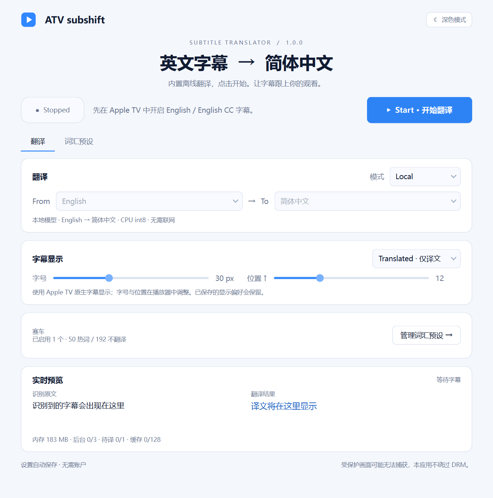

# ATV subshift

**为 Apple TV Windows 客户端提供即时字幕翻译。默认离线英译简中，沿用播放器自身的字幕位置和绘制路径。**

**软件自带一个小型离线英译简中模型，可开箱即用；小模型能力有限，建议优先使用 API，尤其是赛车术语和复杂上下文场景。具体效果取决于所选服务和模型。**

这是基于 0.1.13 封装的 **1.0.0 正式版**，适用于 Windows 11 x64。
默认 Local 模型、浅色界面，内置完整离线模型，以及“赛车”预设的 **50 条热词、192 条不翻译词汇**。

> **AI 生成声明：本软件完全由 AI 生成。** 项目原创代码、界面、集成脚本、测试、文档和打包流程均由 AI 生成并借助工具执行；发布者提供需求、反馈和发布授权。第三方库、预训练模型、开发工具及 Apple 软件仍属于各自原作者，不属于本项目的 AI 原创内容。

## 下载与使用

前往 [Releases](https://github.com/shusheng055/ATV-subshift/releases/latest) 下载 `ATV-subshift-1.0.0-win64.zip`。

1. 完整解压压缩包，保留 `ATV subshift.exe` 旁的 `_internal` 文件夹。
2. 双击 `ATV subshift.exe`，无需安装 Python、登录、填写 Key 或首次下载模型。
3. 在 Apple TV Windows 客户端播放内容，开启 English / English CC 字幕。
4. 在本工具点击 **Start**。**Stop / 退出**会断开接入并恢复原文。

可切换译文 / 双语显示、深色模式和 API 模式。在“词汇预设”页管理赛车词表或添加其他分类。
现有用户继续使用本机已保存的设置；Local / 浅色是全新配置的默认值。



## 软件作用

- 将当前英文字幕翻译为简体中文，并尽量保持 Apple TV 原有的字幕观看方式。
- 提供离线翻译，也可由使用者配置自己的 API 服务、模型和 Key。
- 通过热词和不翻译词汇辅助处理赛车术语、车手名、车队名等内容。
- 保留阅读队列、按字数控制停留和滞后追赶、等待下一条译文期间保留当前字幕的逻辑。
- 限制后台任务、队列和缓存占用，并在停止时释放模型进程及原生接入资源。

## 实现途径

应用使用 **Python + PySide6** 构建 Windows 界面，由 **PyInstaller** 打包。

原生路径通过 **Frida** 观测经过版本和哈希校验的字幕输入，读取 `CFAttributedString` 字幕文本。
译文使用临时字幕对象交回 Apple TV 自身的 **CoreText / QuartzCore** 绘制路径，保留原生字幕位置；停止时恢复。
原生接入不可用时，应用可尝试 Windows 界面文本或 Windows OCR；此时预览结果不代表原生字幕已经替换成功。

Local 模式通过 **SentencePiece + CTranslate2 CPU int8** 运行内置的 **Argos en_zh 1.9 / OPUS-MT** 模型，
由一个专用子进程执行推理。API 模式使用 HTTPX 调用使用者选择的服务，支持上下文和术语保护。

### 开发中使用了 REA

**本项目在开发过程中使用了 [REA（Reverse Engineer Anything）](https://github.com/morluto/rea)，结合 Ghidra 进行静态分析和函数反编译，梳理 Apple TV 相关模块的字幕输入、原生绘制、清除与完成通知路径。**
这些分析用于定位接入点、核对调用顺序，并设计版本、模块哈希和入口代码校验。
REA 是开发分析工具，运行发行软件不需要另行安装 REA 或 Ghidra。
本项目不分发 Apple TV 程序或其系统库，也不修改其已安装文件；不访问解密视频，不绕过 DRM。

## 兼容范围与验证

- 系统：**Windows 11 x64**。
- 原生字幕接入针对 **Apple TV Windows 1.1540.23558.0 x64**；其他版本不保证兼容，校验不匹配时停止原生接入并提示。
- 本版沿用 0.1.13 的原生字幕与资源管理代码，不包含后续 Team Radio 实验功能。
- 通过 **95 项源码测试、31 项打包运行检查**，含真实离线模型翻译、模型进程退出及本机模拟 API。
- 受控检查不等于已完成所有内容的长时间真实播放验证；翻译准确性取决于模型、原始字幕和术语配置。

## 密钥与数据

公开源码和发行文件不包含发布者的 API Key、DPAPI 加密凭据、个人配置或诊断记录。
Local 模式无需 API Key。API 模式需使用者自行填写自己的 Key，待译字幕将发送给所选服务。
设置存于 `%LOCALAPPDATA%/ATVSubshift`，Key 使用 Windows DPAPI 按当前账户加密保存。

## 从源码构建

安装 Python 3.12 x64，在项目目录执行：

```powershell
py -3.12 -m venv .venv
.venv\Scripts\python.exe -m pip install -r requirements-build.txt
.\build.ps1
```

Releases 中的完整源码压缩包包含 `models/` 下的离线模型。通过 Git 克隆仓库时，请另外从完整源码包提取 `models/` 到项目目录。
成品原生兼容性自检需要本机安装上述 Apple TV 版本。

## 权利放弃与第三方许可

**发布者声明：我对本软件中本人可能拥有、并依法有权处分的原创部分，放弃一切可依法放弃的权利。**
原创部分采用 [CC0 1.0 Universal](LICENSE) 公共领域贡献；公众可自由使用、复制、修改、再发布及商业使用，
无需为原创部分向发布者付费或征求许可。无法有效放弃的权利，按 CC0 及 [补充权利放弃声明](RIGHTS-WAIVER.zh-CN.md) 处理。
该声明仅涉及发布者本人的权利，不改变第三方许可，也不表示发布者拥有第三方内容的权利。

第三方模型与依赖继续遵守各自原许可及署名要求，详见
[THIRD-PARTY-NOTICES.md](THIRD-PARTY-NOTICES.md)、[MODEL-ATTRIBUTION.md](MODEL-ATTRIBUTION.md) 和 [第三方许可证全文](THIRD-PARTY-LICENSES.txt)。完整源码包另附 `licenses/` 目录。
本软件按现状提供，不提供任何担保。本项目与 Apple、REA、Frida 及所接入模型服务商无隶属或背书关系。
