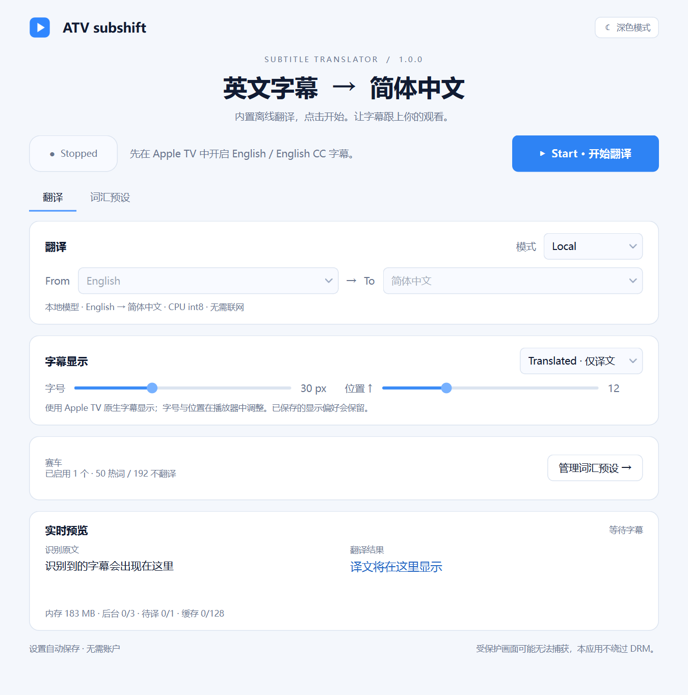

# ATV subshift 1.1.1-local

主要为在 Apple TV Windows 客户端观看 F1 提供即时英文字幕翻译，沿用播放器原生字幕位置和绘制路径。

## 本次更新

- **适配了最新版 Apple TV**：新增 Windows **1.1792.39684.0 x64** 的原生字幕适配，恢复字幕读取、计时及中文/双语绘制，保留 **1.1540.23558.0** 的适配。
- **增强了本地模型**：新增 **HY-MT1.5 7B（Q6_K）** 本地增强引擎，结合 F1 语境、赛车术语和最近三段原文翻译整句，并校验车手名等保留词。

“最新版”指本次已验证的具体版本；Apple TV 后续更新仍需重新验证。版本、模块哈希和入口代码校验继续保留，未知版本不会套用旧地址。

## 下载与使用

从 [Releases](https://github.com/shusheng055/ATV-subshift/releases/latest) 下载 **ATV-subshift-1.1.1-local-win64.zip**。

1. 完整解压，保留 `ATV subshift.exe` 旁的 `_internal` 文件夹。
2. 双击程序，在 Apple TV 中播放内容并开启 English / English CC 字幕。
3. 选择 **Local**，按需选“原版轻量”或完成下面安装后选“本地增强”，点击 **Start**。
4. **Stop / 退出**断开接入并恢复原文。

全新配置默认为 **Local → 原版轻量、浅色界面**，自带小型离线英译简中模型，无需 Python、API Key 或首次下载。现有用户继续使用已保存的设置；保留赛车预设的 **50 条热词、192 条不翻译词汇**。



### 启用本地增强模型

增强模型权重和 Ollama **不包含在软件压缩包中**，需要单独安装。先按 [Ollama Windows 官方说明](https://docs.ollama.com/windows) 安装并启动 Ollama，然后在 PowerShell 执行：

```powershell
ollama pull hf.co/tencent/HY-MT1.5-7B-GGUF:Q6_K
```

下载完成后，在本工具选择 **Local → 本地增强 · 赛车术语与上下文**，启用“赛车”词汇预设并开始翻译。模型由 Ollama 独立管理，需要额外的磁盘和内存/显存；速度取决于硬件，首次加载可能需要数秒。

程序只连接本机 `127.0.0.1:11434`，本地翻译不调用云端 API。增强引擎不可用时会提示原因，可手动切回原版轻量；不会自动转用付费 API。停止时请求卸载增强模型，保留 Ollama 服务供其他应用使用。

参考：[Hugging Face 的 Ollama 使用说明](https://huggingface.co/docs/hub/en/ollama)、[腾讯模型与许可](https://huggingface.co/tencent/HY-MT1.5-7B-GGUF)。本项目增加领域提示和术语处理，没有对模型做 F1 专项微调，也不保证每句准确。

## 功能与实现

- 支持译文/双语显示、词汇预设、浅色/深色界面，以及由用户自行配置的 API 翻译。
- 使用 Python + PySide6 构建界面，通过 PyInstaller 打包。
- 通过 Frida 读取经版本和哈希校验的原生字幕，将临时译文交回 Apple TV 的 CoreText / QuartzCore 绘制路径。停止后恢复原文。
- 保留半句处理、字幕阅读队列、滞后追赶，以及后台任务、队列和缓存限制。
- 原版轻量模型通过 SentencePiece + CTranslate2 CPU int8 运行 Argos en_zh 1.9 / OPUS-MT；增强引擎通过本机 Ollama 运行 HY-MT1.5 7B。
- 原生接入不可用时可尝试 Windows 界面文本或 OCR；预览有译文不代表播放器中的原生字幕已成功替换。

开发使用了 [REA（Reverse Engineer Anything）](https://github.com/morluto/rea) 和 Ghidra 分析字幕调用路径，运行软件无需安装这些开发工具。本项目不分发 Apple TV 程序或系统库，不修改其已安装文件，不访问解密视频或绕过 DRM。

## 兼容性与验证范围

- **Windows 11 x64**；原生接入支持 **Apple TV 1.1792.39684.0 / 1.1540.23558.0 x64**。
- **110 项源码测试、31 项打包运行检查通过**；另有本地增强模型的实际推理检查。
- 新版已进行 CEA-608 字幕的短时播放验证。早期一轮仍出现漏译；部分极短的增量字幕未绘制，不能据此保证所有字幕零遗漏。
- WebVTT 路径已静态适配，尚未完成真实播放验证。短时检查不代表所有节目、所有字幕格式或长时间播放均已验证。

## 密钥与数据

公开文件不包含发布者的 API Key、加密凭据、个人配置或播放诊断记录。本地模式无需 API Key；API 模式由用户自行配置，待译字幕会发送给所选服务。

设置保存在 `%LOCALAPPDATA%/ATVSubshift`，Key 使用 Windows DPAPI 按当前账户加密。升级不覆盖用户已有配置。

## 从源码构建

安装 Python 3.12 x64，在项目目录执行：

```powershell
py -3.12 -m venv .venv
.venv\Scripts\python.exe -m pip install -r requirements-build.txt
.\build.ps1
```

完整源码压缩包包含 `models/` 下的轻量离线模型；Git 仓库不存放模型权重，通过 Git 克隆后请从源码压缩包提取 `models/`。增强模型仍需单独安装。打包自检的原生兼容性检查需要本机安装 Apple TV **1.1792.39684.0**。

## AI 生成声明与权利

**本项目原创代码、界面、集成脚本、测试、文档和打包流程均由 AI 生成并借助工具执行；发布者提供需求、反馈和发布授权。** 第三方库、预训练模型、开发工具及 Apple 软件仍属于各自原作者。

**发布者对本人可能拥有、并依法有权处分的原创部分放弃一切可依法放弃的权利。** 原创部分采用 [CC0 1.0](LICENSE)，另见 [补充权利放弃声明](RIGHTS-WAIVER.zh-CN.md) 和 [AI 生成声明](AI-GENERATED.md)。第三方许可保持不变，详见 [第三方说明](THIRD-PARTY-NOTICES.md)、[模型署名](MODEL-ATTRIBUTION.md)、[许可证汇总](THIRD-PARTY-LICENSES.txt) 与 `licenses/`。

软件按现状提供；本项目与 Apple、REA、Frida 及模型服务商无隶属或背书关系。
